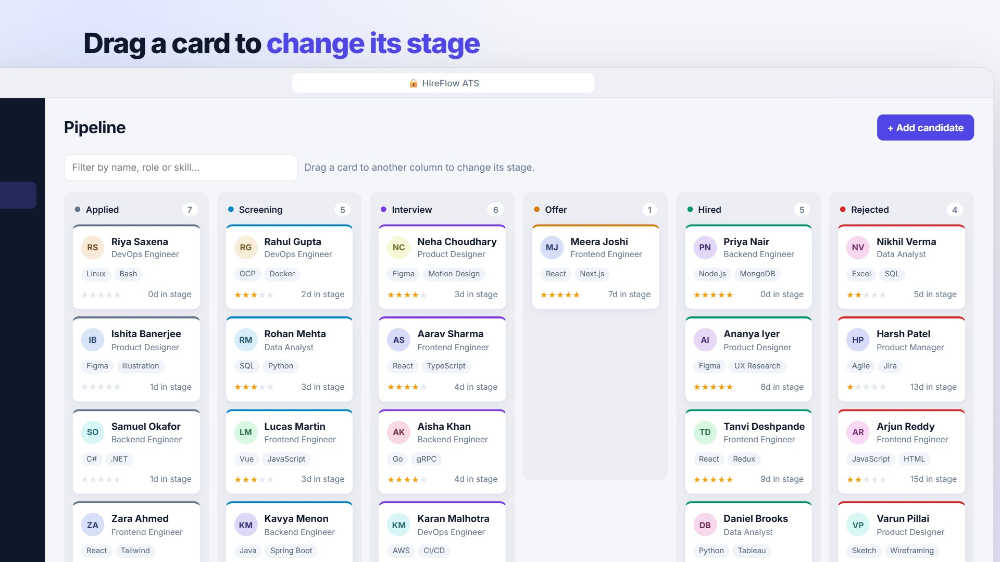

# HireFlow: a mini applicant tracking system

HireFlow is a small MERN app for tracking job candidates. You can add candidates, move them through hiring stages on a drag-and-drop board, search and filter them, and see hiring metrics on a dashboard.

- **Live app:** _add your Render URL here_
- **Demo video:** [brag-output/brag.mp4](brag-output/brag.mp4) (28 s)
- **Demo login:** `admin@hireflow.dev` / `admin123` (already filled in on the login page)



## Features

| Area | What it does |
|---|---|
| **Candidates** | Add, view, edit and delete candidates: name, email, phone, position, experience, skills, source, rating (1–5 stars), resume link and notes. Emails must be unique. |
| **Hiring stages** | Six stages: Applied → Screening → Interview → Offer → Hired, plus Rejected. Drag a card between columns on the Pipeline board, or change the stage in the candidate form. Each change is saved to the candidate's stage history, which the form shows as a timeline. |
| **Search** | One search box matches name, email, position and skills (case-insensitive, partial match). Filter by stage and position, and sort by newest, oldest, name or rating. The board also has a quick filter. |
| **Dashboard** | Total candidates, new this week, active in pipeline, hired and hire rate, and average days to hire. Also shows the current pipeline split, a hiring funnel (how many candidates reached each stage), candidates by source and position, and recent stage activity. |
| **Login** | One admin account set by environment variables, using JWT bearer tokens. Every API route except login needs a token. |

The app seeds 28 demo candidates on first start (only when the database is empty), so the dashboard has data right away.

## Tech stack

- **MongoDB** with Mongoose: one `Candidate` collection, with the stage history stored inside each document
- **Express 5**: REST API, plus serving the built React app in production
- **React 19** with Vite: no UI library, plain CSS, native HTML5 drag-and-drop and the native `<dialog>` element
- **Node 22**: tests use the built-in `node:test` runner with `mongodb-memory-server`

## Run it locally

You need Node 22.12 or newer.

```bash
npm install
```

```bash
npm run dev
```

Open http://localhost:5000. If `MONGODB_URI` is not set, the dev server starts a throwaway in-memory MongoDB, which resets on every restart. To use your own database, copy `.env.example` to `.env` and set `MONGODB_URI`.

Run the API tests (the first run downloads a MongoDB binary, about a minute):

```bash
npm test
```

## Deploy (MongoDB Atlas + Render, both free)

1. **Atlas:** create a free M0 cluster, add a database user, and under *Network Access* allow `0.0.0.0/0`. Copy the connection string and add a database name, for example `.../hireflow?retryWrites=true&w=majority`.
2. **Render:** choose *New → Blueprint* and pick this GitHub repo. Render reads `render.yaml`, which sets the build and start commands, `NODE_ENV`, a generated `JWT_SECRET` and the demo admin login.
3. When Render asks for `MONGODB_URI`, paste the Atlas string. The first deploy seeds the demo data.

The free Render plan sleeps after 15 minutes without traffic, so the first request after that takes about 30 seconds. Data stays in Atlas.

## API

All routes except login need `Authorization: Bearer <token>`.

| Method | Route | Purpose |
|---|---|---|
| POST | `/api/auth/login` | `{ email, password }` → `{ token }` |
| GET | `/api/candidates?q=&stage=&position=&sort=` | Search and filter. `sort` is `newest`, `oldest`, `name` or `rating` |
| POST | `/api/candidates` | Create a candidate (starts its stage history) |
| GET | `/api/candidates/:id` | One candidate, including stage history |
| PATCH | `/api/candidates/:id` | Update fields. A stage change adds a history entry |
| DELETE | `/api/candidates/:id` | Delete a candidate |
| GET | `/api/stats` | Dashboard metrics |
| GET | `/api/meta` | Stages, sources and existing positions for the forms |

Errors come back as `{ error }` with status 400 (validation), 401, 404 or 409 (duplicate email).

## Project structure

```
server/
  index.js            starts the server: connects to Mongo, seeds, serves the client
  app.js              Express routes, auth, validation and error handling
  models/Candidate.js schema, stages and sources
  seed.js             28 demo candidates with realistic stage histories
  test/api.test.js    API tests
client/
  src/App.jsx         layout, hash routing, candidate modal state
  src/Dashboard.jsx   metrics
  src/Pipeline.jsx    kanban board with drag-and-drop
  src/Candidates.jsx  search, filters, table
  src/CandidateModal.jsx  add / edit / delete form with stage timeline
render.yaml           one-click Render deploy
```

## Choices and limits

- There is one admin user, configured by environment variables. That covers the assignment. Multi-user accounts and roles would be the next step.
- The search uses escaped, case-insensitive regex. That is fine at this size; a MongoDB text or Atlas Search index would replace it for large datasets.
- `/api/stats` computes metrics in JavaScript over all candidates, which is fine for thousands of records. Past that, it should move to an aggregation pipeline.
- Not included: pagination, resume file uploads, email notifications, interview scheduling and dark mode.
